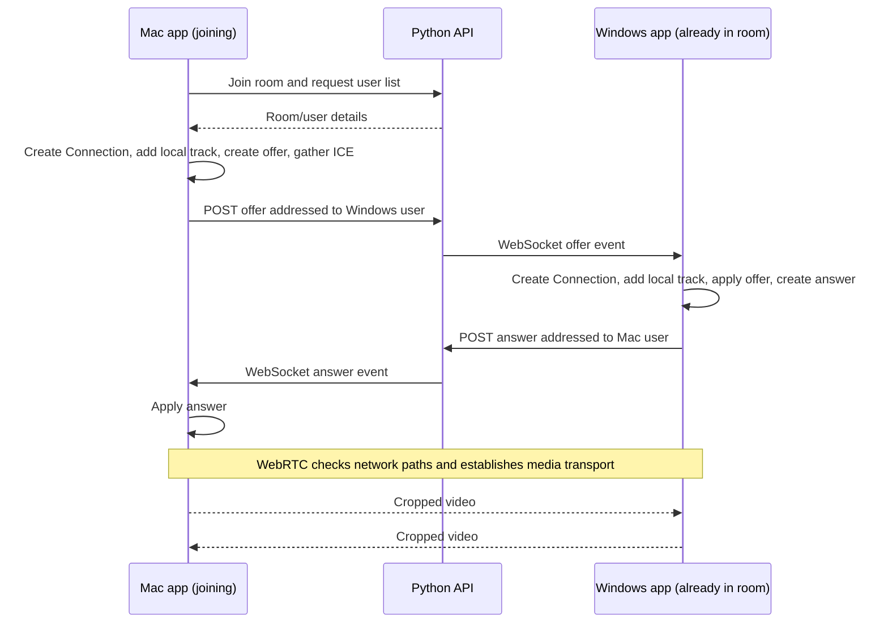

# Invycam: following one screen share through the app

This is a reading companion for the current code, not a redesign. Follow one successful session: you open Invycam on Windows, your friend opens it on a Mac, both select a screen region, and your friend joins your room.

## 1. The pieces and their jobs

| Piece | What it does | Start reading here |
| --- | --- | --- |
| Electron main process | Creates the desktop window, controls mouse interaction, provides a screen capture source | `public/main.js` |
| Preload | Exposes a small desktop API as `window.ipc` for React | `public/preload.js` |
| React | Shows menus, selection rectangles, previews, and remote videos | `src/App.jsx` |
| ConnectionManager | Coordinates your capture, room membership, signaling, and connections to other users | `src/Utils/ConnectionManager.js` |
| Connection | Manages WebRTC for one other user | `src/Utils/Connection.js` |
| Python API | Tracks rooms/users and forwards connection messages | `../Invycam-api/main.py` |
| Zustand stores | Keep information React uses to display the interface | `src/Hooks/` |

Each app has one exported ConnectionManager instance. Its `peerConnections` object holds one Connection per other user, keyed by their user ID. With two people, each app has one Connection. With three people, each has two.

Your Connection class wraps the browser's `RTCPeerConnection`. The wrapper is your code; the underlying object implements WebRTC.

## 2. Opening the app

In `main.js`, Electron waits until it is ready, creates the window, and starts the global keyboard listener. In development, the window loads React from port 3000.

The preload script exposes functions such as `window.ipc.enterOperationMode()`. React calls those to ask the main process to change native window behavior.

F2 follows this path:

```text
keyEventListener.js detects F2
  -> main process sends "open-menu" to the window
  -> preload's registered listener receives it
  -> preload requests restored window interaction
  -> preload calls the callback registered by App.jsx
  -> React changes mode to "menu"
```

Registering the callback happens earlier, when App mounts. Pressing F2 triggers the already-registered callback.

## 3. Selecting a region creates your local video

Read `App.jsx`'s selection effect, then `ConnectionManager.setLocalStream()`.

App tracks your mouse movement to draw a rectangle. Pressing Enter reads its position and size, then passes those coordinates to `setLocalStream()`.

That function builds this pipeline:

```text
Screen capture
  -> internal video element plays the captured screen
  -> drawImage copies the selected rectangle onto a canvas
  -> canvas.captureStream(10) creates the cropped video stream
  -> local preview and WebRTC use that cropped stream
```

`getDisplayMedia()` requests screen capture. The handler in Electron's `main.js` supplies the first screen source. The cropping happens afterward, in the canvas.

The internal video element gives `drawImage()` a source of live screen frames. `updateCanvas()` schedules repeated drawing with `requestAnimationFrame`. `captureStream(10)` creates a live stream from that canvas with a requested capture rate of 10 FPS. This does not save a video file.

Two terms matter here:

- **MediaStream:** a container for media tracks.
- **MediaStreamTrack:** one video or audio feed inside that container.

Your current cropped stream has a video track and no audio track. `stream.getVideoTracks()[0]` gets that video track.

One naming trap in your code: **ConnectionManager.localStream is a MediaStream, but Connection.localStream currently holds a MediaStreamTrack**, assigned using `localStream.getTracks()[0]`. The same name refers to different types in those two classes.

## 4. Creating a room registers you with Python

Read `RoomOptionsForm.jsx`, `ConnectionManager.createRoom()`, and Python's `/api/create-room` endpoint.

The form calls the manager. The manager sends an HTTP request with the room name and username. Python creates entries in its in-memory dictionaries and returns a room ID, user ID, room key, and message.

The manager saves those values, updates the React store, and opens a WebSocket to Python using the user ID.

There are three separate communication paths:

| Path | What Invycam sends through it |
| --- | --- |
| Electron IPC | Messages between React/preload and the local desktop main process |
| HTTP and WebSocket | Room requests, offers, answers, usernames, and room events between apps and Python |
| WebRTC | Live video between the users' apps |

Python receives outgoing offers/answers through HTTP and forwards them to the intended recipient through their WebSocket. It does not process the screen video.

The room's host is a room-management role. Other users' video does not need to pass through the host's app.

## 5. Your friend joins: offer, answer, then media

Read `joinRoom()` and `sendOffer()` in the manager, then the offer/answer methods in Connection.

Joining first registers your friend with Python. The manager then opens their WebSocket, requests the room's users, and creates a Connection for each existing user other than themselves.

In this example, **the joining Mac sends the offer** and **the existing Windows user sends the answer**.



An **offer** describes the proposed media session. An **answer** describes the compatible session the other side agrees to. Their `sdp` text includes technical media and connection details; it is not the video itself.

`setLocalDescription()` applies your side's description. `setRemoteDescription()` applies the other side's description. “Local” always means the app running that code.

**ICE candidates** describe potential network paths. Your `gatherIceCandidates()` collects candidates before sending them together with the offer or answer. `addIceCandidate()` gives the other side's candidates to WebRTC. WebRTC then checks connectivity; exchanging an answer alone does not prove video is flowing.

The configured STUN server helps discover an externally visible network address. It does not carry your video.

One useful distinction: the UI sets `roomStatus` to `connected` after the room API succeeds. That means room registration succeeded; the peer video connection may still be getting established.

## 6. How received video reaches the interface

In Connection's constructor:

```js
this.peerConnection.addEventListener('track', async (event) => {
    this.remoteStream = event.streams[0]
})
```

The track event gives your code access to incoming media. This handler stores the associated stream. It is not a callback for every video frame.

`PeerCard.jsx` calls `peer.getRemoteStream()`. Your method polls until that saved stream exists, or times out. The card then does:

```js
video.current.srcObject = stream
```

That connects the live stream to the video element. The browser handles displaying subsequent frames.

The peer's name comes from signaling metadata, while the picture comes from WebRTC. Seeing a name alone doesn't prove the media path works.

Adding a peer to the overlay stores that peer in `useModeStore.onScreenPeers`. The Operation page renders `OnScreenRemoteStream` components for those selections. Moving a friend's overlay changes where you display their video; changing your own capture rectangle changes what you send.

## 7. Why changing capture needs replaceTrack()

During the initial connection, `addTrack(track, stream)` attaches your local video track to WebRTC. It returns an **RTCRtpSender**: the object responsible for sending that track through this connection.

Think of the objects as:

```text
MediaStream contains a video track
                           |
                           v
                     RTCRtpSender
                           |
                           v
                  RTCPeerConnection -> friend's incoming video
```

When you edit the captured region, `setLocalStream()` stops the old tracks and creates a new canvas stream. Assigning the new stream to a variable or React's store updates your local references. The existing sender still points to its old track.

The added loop gets the new video track, finds each connection's video sender, and calls:

```js
await sender.replaceTrack(newVideoTrack)
```

The sender switches its input to the new track while keeping the existing connection. Each friend has a separate sender in your app, so the loop updates each one. The replacement is intended to work within the existing negotiated video session; failures propagate to the surrounding catch. The two-machine capture-edit test still needs to verify this change.

## 8. Your next task: join before sharing

Currently both `createOffer()` and `createAnswer()` assume a local stream exists. Calling `.getTracks()` on null caused the error you saw.

Your desired state is valid: “I'm in the room and receiving video, but I'm not sharing yet.” You don't need a fake stream. There are two separate jobs to understand before implementing it:

1. Build the connection without dereferencing a missing local stream.
2. Start sending a real track later through a connection prepared for video.

A **receiver** handles incoming media. A **transceiver** groups a sender and receiver for one media kind, along with their negotiated direction. This is the next concept to learn when preparing a video connection before a local track exists.

Also revisit the current sender lookup: `sender.track?.kind === "video"` cannot identify a sender whose track is null. That matters for starting capture after joining. This guide does not implement that task.

## 9. Leaving and a detail to revisit

The intended flow is: request leave, remove room membership, notify remaining users, return a response, and reset local room/peer state. Remaining apps handle a `disconnect` event by closing and removing that user's Connection. Host reassignment changes room-role metadata.

In the current local Python file, `return {"message": "Successfully left the room"}` appears **before** the dictionary deletion code. Returning exits the function, so the cleanup statements below it cannot execute on that path. There is also cleanup in the WebSocket disconnect handler; that can obscure what actually completed.

The current frontend host-reallocation notification also reads `peerConnections[new_host_id].username` before the later existence check. When you become host, you don't have a peer entry for yourself. These are reading notes from the current files, not changes made by this guide.

## A manageable reading order

Read one path at a time rather than every file in full:

1. **Capture:** App's Enter handler -> manager's `setLocalStream()`.
2. **Room registration:** form submit -> `createRoom()` / `joinRoom()` -> Python endpoint.
3. **One connection:** `sendOffer()` -> `createOffer()` -> WebSocket offer handler -> `createAnswer()` -> answer handler -> `processAnswer()`.
4. **Display:** Connection's track listener -> `getRemoteStream()` -> PeerCard's `srcObject` assignment.
5. **Change the feed:** return to `setLocalStream()` and trace the sender replacement loop.

At each step, ask: what object do I have, who owns it, and what happens next? You can understand this flow before learning every WebRTC option.
